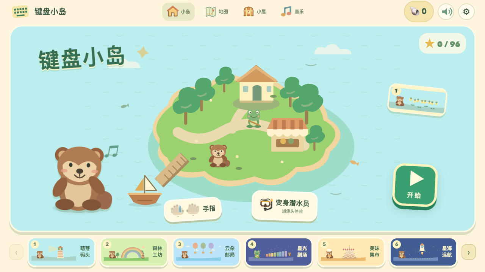

# 键盘小岛 · Keyboard Island

[](https://github.com/shaom/keyboard-island/actions/workflows/ci.yml)
给刚接触实体键盘的孩子准备的打字冒险游戏。

**[English](README.md)** · [在线体验](https://keyboard-island-doudou.groovy-river-7567.chatgpt.site/) · [隐私说明](PRIVACY.md) · [参与贡献](CONTRIBUTING.md)



和豆豆一起叫醒萤火虫、修桥、送信、演奏音乐，再去新的世界冒险。每次正确按键都会改变画面；没有倒计时，按错可以继续试。

## 两个独立系列

新旧游戏各有入口、课程和浏览器存档。

| 系列                            | 在线体验                                                                                         | 源码与本地启动                                                                                                                 |
| ------------------------------- | ------------------------------------------------------------------------------------------------ | ------------------------------------------------------------------------------------------------------------------------------ |
| 键盘小岛 · Keyboard Island      | [原有 96 关冒险](https://keyboard-island-doudou.groovy-river-7567.chatgpt.site/)                 | `public/` · `node scripts/serve.mjs`                                                                                           |
| 句子邮局 · Sentence Post Office | [32 封英文来信](https://sentence-post-office-doudou.groovy-river-7567.chatgpt.site/post-office/) | [games/sentence-post-office](games/sentence-post-office/README.zh-CN.md) · `node games/sentence-post-office/scripts/serve.mjs` |

[打开插画系列选择页](https://sentence-post-office-doudou.groovy-river-7567.chatgpt.site/)。句子邮局练习首字母大写、单词空格和句末标点，逐字正确后才能继续，并提供图形提示、音效和 16 枚收藏邮票。儿童界面使用简单英文，家长设置使用中文。以下内容仍为原键盘小岛的说明。

## 已有内容

- **16 个世界、96 关、288 个情节阶段**。
- 从 F/J 定位与基准行开始，逐步练习上下排字母、数字、空格、另一侧 Shift、大写、退格修改、回车及短句。
- 大图标与目标字母、手指示意、场景动作、音乐音效、贴纸和纪念章。
- **36 件小屋装扮、6 个分类**；已兑换的物品可以免费切换摆放。
- 自由音乐游乐场。
- 可选实时潜水员：在本机检测并放大人脸，平滑跟随到卡通头盔里。
- 浏览器自动存档，保存关卡中途进度、练习记录、贝壳、收藏和设置。

README 提供中英文版本，**游戏界面与故事当前仍为简体中文**。拼音章节练习字母串，不包含中文输入法选字。建议使用实体 QWERTY 键盘；手机布局可以浏览，但主要关卡不是为触摸键盘设计的。

## 本地运行

安装 **Node.js 20 或更新版本**，无需安装依赖或构建：

```sh
node scripts/serve.mjs
```

打开 **http://127.0.0.1:4173/**。更换端口：

```sh
node scripts/serve.mjs --port 4180
```

也可以用 Python 静态服务器：

```sh
python3 -m http.server 4173 --bind 127.0.0.1 --directory public
```

摄像头功能需要 localhost 或 HTTPS，以及浏览器许可。不要使用 `file://` 直接打开页面来运行摄像头和模型。没有摄像头、拒绝许可或模型无法运行时，仍可以使用卡通角色。

## 开源版配音

**音乐和游戏音效完整保留**，在浏览器中通过 Web Audio 合成。

原在线版的配音 MP3 **暂不随开源项目分发**：目前没有足够依据确认这些服务生成录音可以再分发。项目保留了 [147 条完整对白、ID 和参考时长](docs/voices/transcripts.json)，以及配音调度接口。缺少录音时不会请求不存在的文件，游戏照常可玩，也不会自动改用系统朗读或云端配音。

拥有可使用的录音包后，按对白 ID 命名，例如 `intro-0.mp3`、`key-F.mp3`，然后执行：

```sh
node scripts/import-voices.mjs /录音目录的绝对路径
```

导入器会先检查所有文件，再复制录音并生成播放清单；之后在家长设置中开启语音。播放结束时间以实际音频为准，参考时长不会截断录音。详见 [Voice packs](docs/VOICE_PACKS.md)。

在线体验与开源包是两个独立交付，项目许可证不包含下载、再分发在线录音的授权。

## 存档和隐私

存档键保持 **`keyboard-island-v1`**。同一浏览器用户、同一来源地址关闭再打开后可以继续；域名、协议或端口变化会产生独立存档。无痕模式、清除站点数据或浏览器存储策略可能使进度消失。本版没有账号、云同步、存档导入导出或清空全部进度的界面；可以从地图重玩已解锁章节。

摄像头只在主动点击开启并允许后使用，**只请求视频，不请求麦克风**。运行库和模型随项目提供，在本机 Worker 中检测；画面在内存中裁切显示，不录像、不编码、不上传、不保存人脸数据。退出体验、隐藏页面、按 Esc 或点击关闭都会停止摄像头。详见 [PRIVACY.md](PRIVACY.md)。

游戏代码没有统计追踪或广告；网站托管方仍可能记录普通网页访问日志。

## 开发与检查

```sh
npm ci
npm run check
npm test
npx playwright install chromium
npm run test:e2e
npm run format:check
```

`check` 检查代码语法、课程结构、资源引用和第三方文件哈希；单元测试覆盖旧课程兼容、配音清单、人脸裁切几何和静态服务器；浏览器测试覆盖通关、旧存档、键盘默认行为、装扮兑换和模拟摄像头生命周期。完整通关检查需要几分钟。测试不调用真实摄像头，也不使用孩子照片。完整目录和代码结构见 [English README](README.md#project-layout) 与 [架构说明](docs/ARCHITECTURE.md)。

## 发布

把 **`public/` 里的内容**上传到支持 HTTPS 的静态网站托管服务即可；发布目录为 `public`，无需构建。更新时保持网址来源不变，有助于保留存档。嵌入其他网页时，外层页面和浏览器也必须允许摄像头访问，游戏不能绕过权限提示。

项目不包含 OpenAI Sites 标识、凭据、用户存档或部署历史。发布前请参照 [检查清单](docs/RELEASING.md)。

## 贡献与许可

欢迎改进无障碍体验、原创插画、场景互动、界面翻译、浏览器兼容和具备明确再分发许可的配音。参见 [CONTRIBUTING.md](CONTRIBUTING.md)。

自行开发的代码、原创 SVG、故事、对白和文档采用 **MIT 许可证**。开发过程中使用了 AI 辅助代码和插画。第三方资源保留各自许可：MediaPipe 运行库与 BlazeFace 模型为 Apache-2.0；Emoji 外观由设备字体决定。详见 [LICENSE](LICENSE) 和 [THIRD_PARTY_NOTICES.md](THIRD_PARTY_NOTICES.md)。
