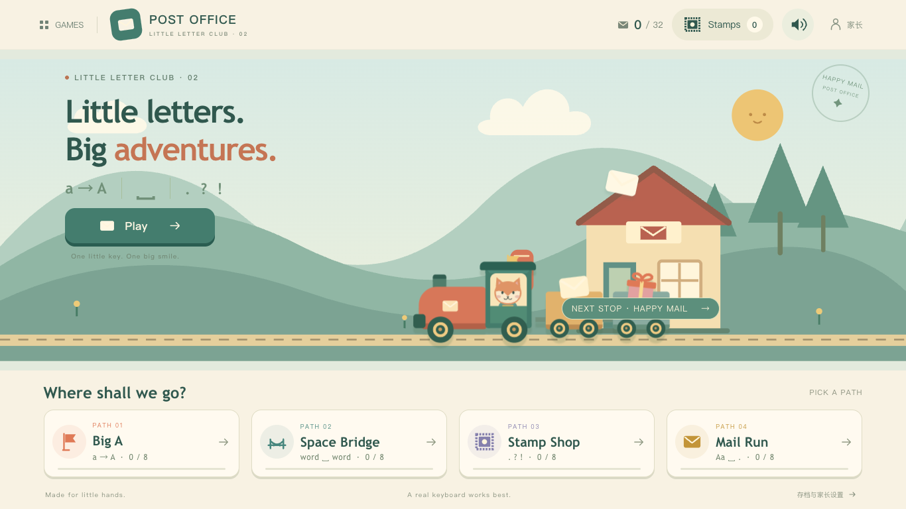

# Sentence Post Office · 句子邮局

An independent, illustrated typing game for a child practicing English capitalization, word spaces and sentence-ending punctuation. This is an independent series, separate from Keyboard Island.

**[Play online](https://sentence-post-office-doudou.groovy-river-7567.chatgpt.site/post-office/)** · [Series entrance](https://sentence-post-office-doudou.groovy-river-7567.chatgpt.site/) · [Source code](https://github.com/shaom/keyboard-island/tree/main/games/sentence-post-office)



## Play locally

Use Node.js 20 or newer:

```sh
node scripts/serve.mjs
```

- Series entrance: http://127.0.0.1:4186/
- Sentence Post Office: http://127.0.0.1:4186/post-office/

The series entrance also links to the existing hosted Keyboard Island. Its source, website and saved progress are unchanged.

## What's included

- Four independent paths with eight letters each: Big A, Space Bridge, Stamp Shop and Mail Run.
- Strict character-by-character progression. Wrong case, missing spaces and incorrect punctuation cannot advance the input. A correct retry clears the warning.
- Large illustrated characters, animated key/space/stamp cues, a brief shake and soft sound feedback. No countdowns or score penalties.
- A train delivery scene with different recipient reactions, and 16 collectible stamps. Two unique delivered letters earn one stamp; replays do not duplicate rewards.
- Small English labels and visual instructions for children; detailed Chinese parent settings.
- Separate sound/music controls and volume; all audio is synthesized locally. No speech engine or third-party audio files.
- Automatic local progress and in-progress drafts, plus a parent reset control with confirmation.

The capitalization path starts empty, spacing starts at the first word boundary, and punctuation starts just before the final mark. Full-sentence missions start empty. The accepted prefix is always correct. Backspace may remove its last character, while subsequent typing always continues at its end. The game supports case-correct keyboard input without enforcing a particular Shift hand.

## Data

Only `sentence-post-office-v1` is written to browser localStorage. The game never reads or writes `keyboard-island-v1`. The exact same protocol, hostname and port are needed to resume the same save. Clearing site data or using private browsing may remove progress. If storage is unavailable, play still works and a notice explains that progress cannot be saved.

No accounts, camera, microphone, analytics, external fonts, network speech or cloud uploads. Resources and art ship with the project. A physical QWERTY keyboard is recommended. The layout adapts to narrow browser panels; touch keyboards are not the main training target.

## Verification

```sh
npm ci
npm test
npm run test:e2e
```

The Playwright configuration uses an installed Google Chrome locally, bundled Chromium in CI, and a separate local server on port 4188. In CI, install Chromium first with `npx playwright install --with-deps chromium`. Tests cover all 32 letters, case/space/punctuation blocking, native Shift input, drafts, reward deduplication, the old save remaining unchanged, unavailable storage, reduced motion, independent audio controls, screen fit and resource errors. Test screenshots are saved in `docs/images/`.

Production files are in `public/`; there is no build step. This series is hosted separately on ChatGPT Sites. Its source lives in `games/sentence-post-office/` in the Keyboard Island repository. Site identity, deployment credentials, browser saves and development caches are not part of the open-source files.

[中文说明](README.zh-CN.md) · [Design notes](docs/DESIGN.md)
